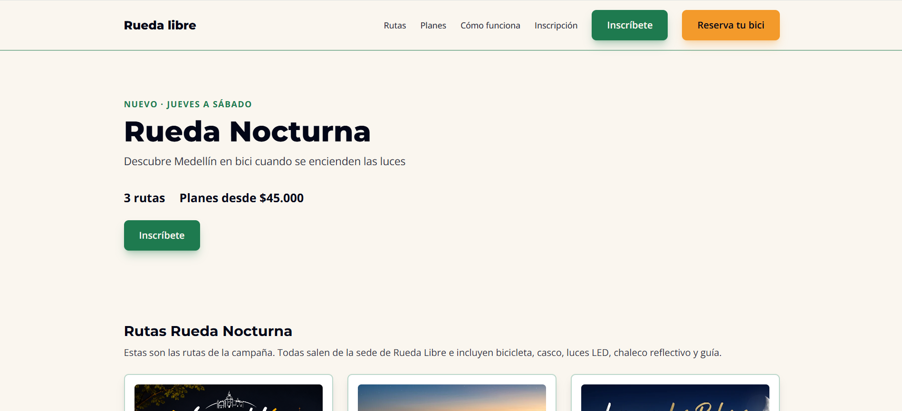
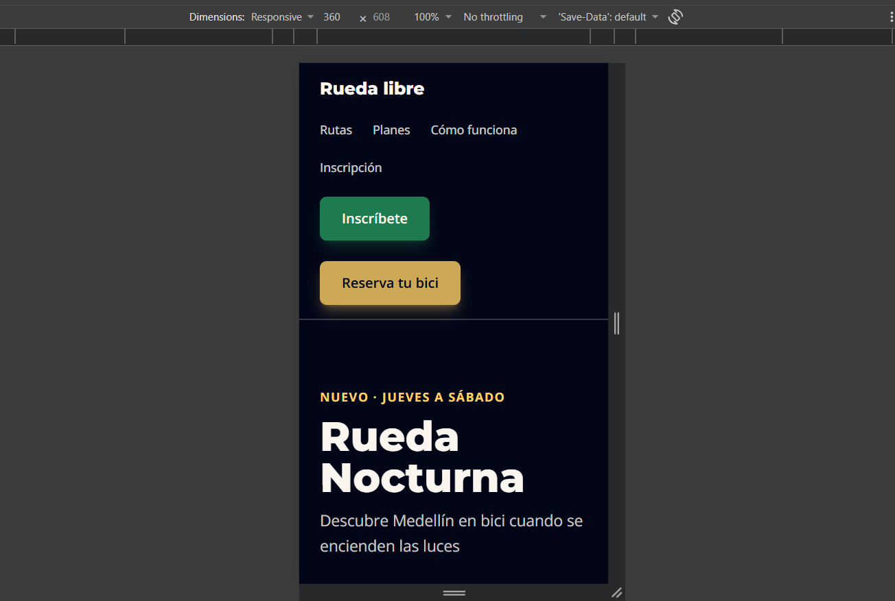

# 🚴 Rueda Libre | Rueda Nocturna

## Descripción del proyecto

Rueda Libre es un sitio web dedicado al alquiler de bicicletas y a los recorridos guiados en Medellín.

Como parte del proyecto, desarrollamos **Rueda Nocturna**, una campaña que invita a explorar la ciudad en bicicleta durante la noche, con diferentes rutas, niveles de dificultad y un formulario de inscripción.

El objetivo es integrar el sitio principal con la landing de la campaña y ofrecer una experiencia clara, accesible y adaptable a diferentes dispositivos.

## Enlaces del proyecto

- **Sitio principal:** [Rueda Libre](https://juandasan1432-commits.github.io/Rueda-libre/)
- **Landing:** [Rueda Nocturna](https://juandasan1432-commits.github.io/Rueda-libre/nocturna/index.html)
- **Reservas:** [Formulario de reservas](https://juandasan1432-commits.github.io/Rueda-libre/paginas/Reservas.html)
- **Repositorio:** [Código en GitHub](https://github.com/juandasan1432-commits/Rueda-libre)

*La verificación final de la publicación y de todos los enlaces está pendiente.*


### Sitio principal

- `index.html`: presentación de Rueda Libre, servicios, flota y rutas.
- `paginas/Tarifas.html`: precios de alquiler y recorridos guiados.
- `paginas/Reservas.html`: formulario para reservar bicicletas.

### Rueda Nocturna

- `nocturna/index.html`: página de la campaña con rutas nocturnas e inscripción.
- `nocturna/componentes.html`: kit de componentes reutilizables.
- `nocturna/prototipo.html`: prototipo inicial de la campaña.

- **HTML5:** estructura semántica, formularios y accesibilidad.
- **CSS3:** estilos del sitio principal.
- **Tailwind CSS 3:** diseño de la landing y sus componentes.
- **Flexbox y CSS Grid:** organización de los elementos.
- **Git y GitHub:** control de versiones.
- **GitHub Pages:** publicación.
- **Visual Studio Code:** entorno de desarrollo.

No se utilizó Bootstrap.

## Identidad visual

Colores de marca:

| Color | Código |
|---|---|
| Verde Ruta | `#1E7A4F` |
| Naranja Pedal | `#F39A2B` |
| Azul Noche | `#020617` |
| Crema | `#FAF6EF` |
| Amarillo Farol | `#FFD166` |

Tipografías:

- **Montserrat:** títulos y encabezados.
- **Open Sans:** párrafos y contenido general.

El diseño de Rueda Nocturna incluye soporte para modo oscuro mediante las variantes `dark:` de Tailwind.
 

Para Rueda Nocturna recomiendo utilizar **Tailwind CSS 3**.

Sus clases utilitarias permiten desarrollar componentes responsive, reutilizar estilos y mantener consistencia visual. También facilita aplicar cambios de modo oscuro y estados de interacción.

El sitio principal conserva CSS tradicional para aprovechar el trabajo ya construido sin introducir dependencias innecesarias.

En Tailwind 3 utilizamos `tailwind.config.js` para definir colores y fuentes personalizados, y `@apply` para reunir estilos comunes en componentes como los botones.

## Instalación y ejecución

Clonar el repositorio:

```bash
git clone https://github.com/juandasan1432-commits/Rueda-libre.git
```

Entrar al proyecto Tailwind:

```bash
cd Rueda-libre/nocturna
npm install
npm run watch
```

Para generar el CSS minificado de producción:

```bash
npm run build
```

La página principal puede abrirse utilizando Live Server en VS Code.

## Capturas de pantalla

Las capturas deben guardarse en la carpeta `capturas/` de la raíz del repositorio.


*Estas imágenes se mostrarán cuando los archivos se guarden y se suban al repositorio.*


El proyecto utiliza:

- Elementos semánticos de HTML.
- Textos alternativos en imágenes informativas.
- Etiquetas asociadas a los campos del formulario.
- Agrupación de campos con `fieldset` y `legend`.
- Validaciones nativas con `required`, `minlength`, `pattern`, `min` y `max`.
- Estados de enfoque para navegación mediante teclado.
- Diseño adaptable con puntos de quiebre de Tailwind.

Los formularios están desarrollados como frontend; no cuentan con un servicio de almacenamiento o recepción de datos.


## Aprendizajes

Durante el desarrollo aprendí a:

1. Crear páginas utilizando HTML semántico.
2. Utilizar Tailwind CSS y su herramienta CLI.
3. Construir componentes reutilizables.
4. Trabajar con Flexbox, Grid y diseño mobile-first.
5. Configurar los colores y las fuentes de una marca.
6. Implementar un modo oscuro.
7. Crear formularios accesibles con validaciones HTML.
8. Conectar páginas mediante rutas relativas.
9. Utilizar Git y GitHub para gestionar versiones.
10. Preparar y documentar un proyecto web para su publicación.

## Capturas del proyecto

### Vista de escritorio


### Vista de celular


### Modo oscuro
.png)
